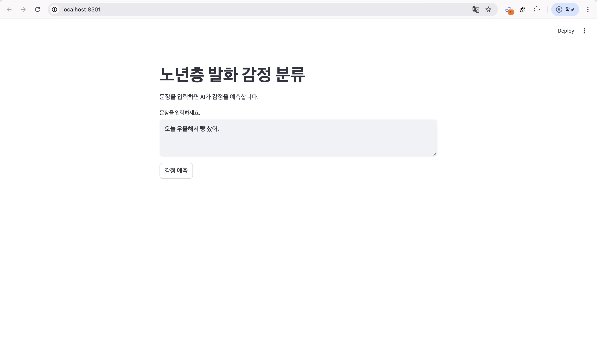
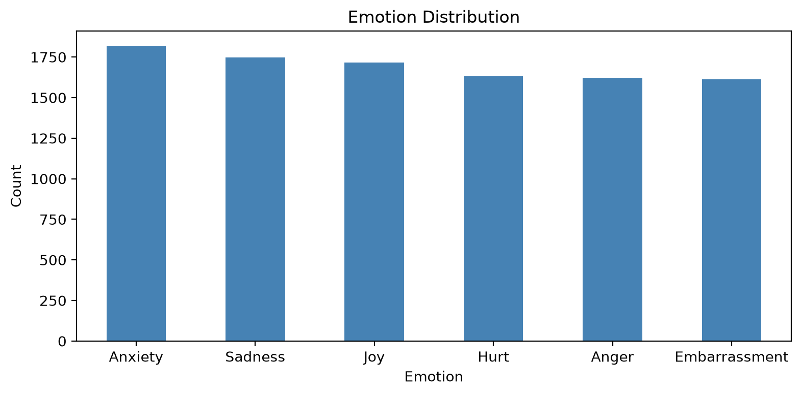
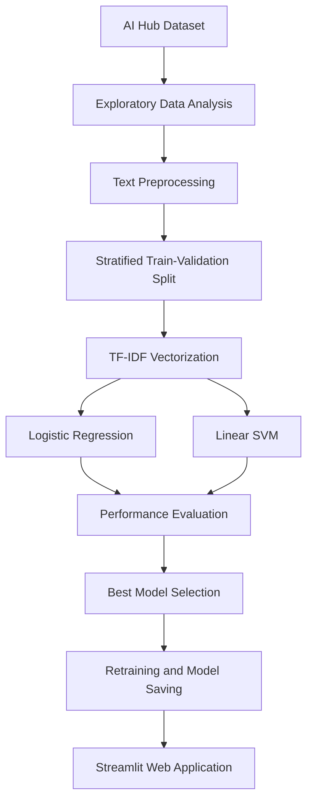
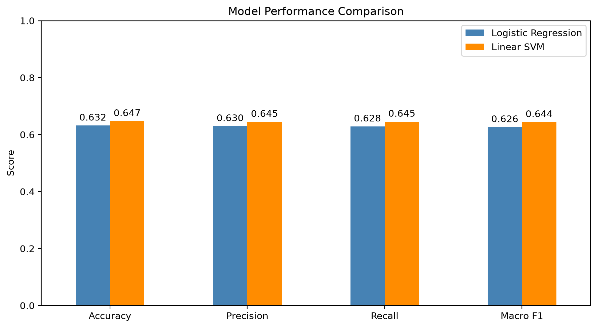
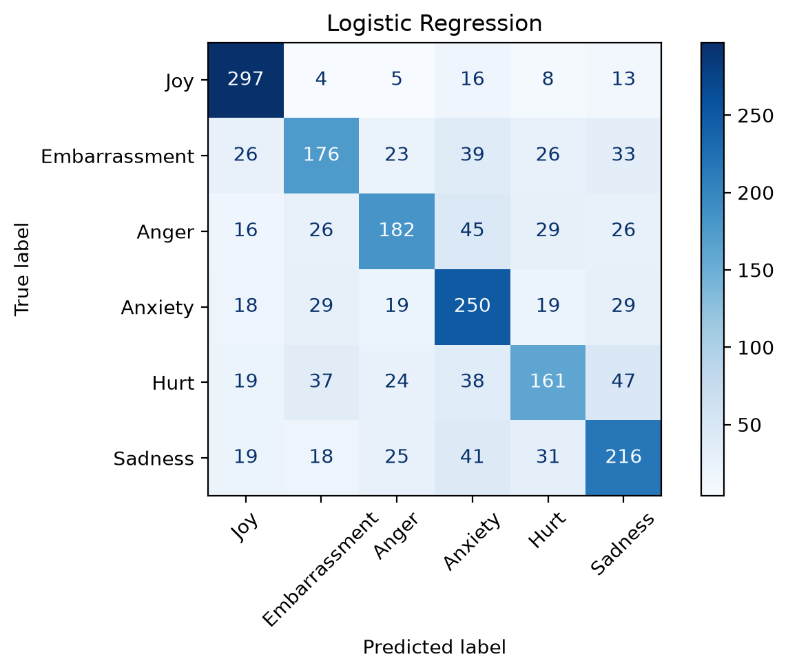
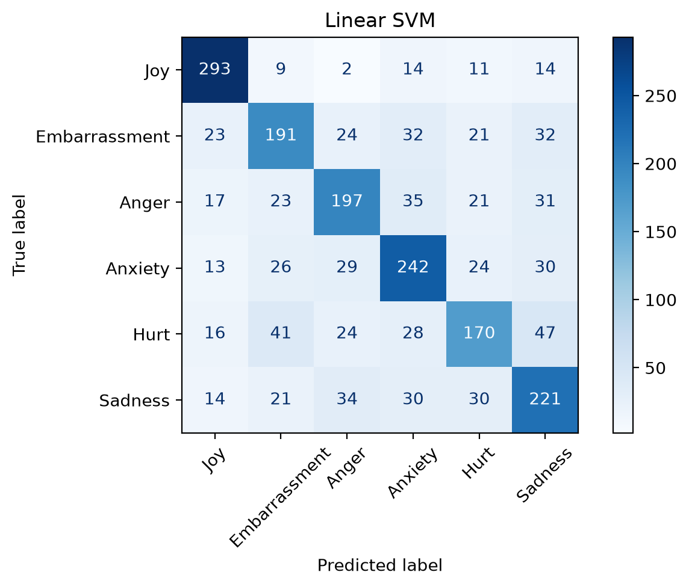
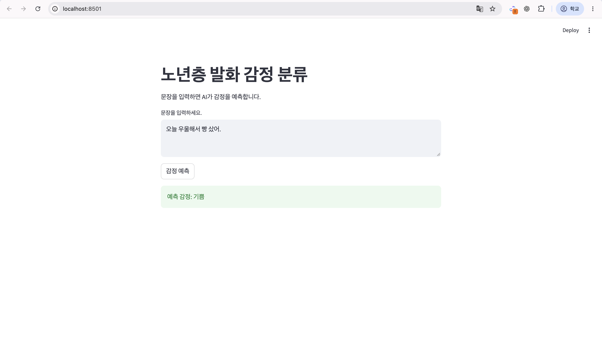

# Elderly Emotion Classifier
### TF-IDF와 지도학습 기반 한국어 감정 분류 서비스

## 1. Project Overview

AI Hub의 노년층 감정 데이터를 활용하여 한국어 발화에
포함된 감정을 분류하는 기계학습 프로젝트입니다.

Logistic Regression과 Linear SVM의 분류 성능을 비교하고,
최종 선정된 모델을 Streamlit 웹 서비스에 연동하여
사용자가 직접 입력한 문장의 감정을 예측할 수 있도록 구현했습니다.

- 개발 형태: 개인 프로젝트
- 개발 배경: 기계학습프로그래밍 수업
- 학습 방식: 지도학습 기반 다중 클래스 분류
- 최종 모델: TF-IDF + Linear SVM
- 분류 대상: 기쁨, 당황, 분노, 불안, 상처, 슬픔



## 2. Motivation

평소 심리학과 인공지능에 관심을 가지고 있었으며,
사람의 언어적 표현을 통해 감정을 인식할 수 있는
모델을 개발하고자 본 프로젝트를 진행했습니다.

특히 노년층의 발화 데이터를 활용하여 감정을 분류함으로써
향후 정서적 지원 및 심리 상태 파악을 위한 서비스에
활용할 수 있는 가능성을 탐색하고자 했습니다.

단순한 모델 구현에 그치지 않고, 실제 일상 표현을 입력하며
기계학습 모델이 사람의 감정과 문맥을 어느 정도까지
이해할 수 있는지 분석하는 데 중점을 두었습니다.

## 3. Tech Stack

| Category | Technology |
|---|---|
| Language | Python 3.13 |
| Data Processing | Pandas |
| Feature Extraction | TF-IDF |
| Machine Learning | Scikit-learn |
| Model | Logistic Regression, Linear SVM |
| Visualization | Matplotlib |
| Model Serialization | Joblib |
| Web Application | Streamlit |
| Development Environment | VS Code, Jupyter Notebook |

## 4. Dataset

- 출처: [AI Hub](https://www.aihub.or.kr/)
- 데이터: 노년층 감정 분류 데이터
- 학습 데이터: 10,150개
- 테스트 데이터: 1,276개
- 감정 클래스: 6개

### Emotion Distribution



감정 클래스별 데이터 분포를 확인한 결과,
특정 클래스에 데이터가 과도하게 집중되어 있지 않아
별도의 오버샘플링을 적용하지 않았습니다.

학습 데이터는 Stratified Sampling을 적용하여
각 감정의 비율을 유지한 상태로 분할했습니다.

| Dataset | Samples |
|---|---:|
| Training | 8,120 |
| Validation | 2,030 |
| Test | 1,276 |

※ AI Hub 데이터 이용 조건을 고려하여 원본 데이터와
개별 테스트 예측 결과는 본 저장소에 포함하지 않았습니다.

## 5. Machine Learning Pipeline



### 5.1 Data Preprocessing

- 사용자 발화 문장 1~4 추출 및 결합
- 결측 문장 제외
- 불필요한 공백 및 줄바꿈 정리
- 시스템 응답 및 성별 정보 제외
- 감정 대분류를 Target Label로 설정
- 학습 및 검증 데이터 8:2 분할

감정 표현에 영향을 줄 수 있는 부정 표현이나 문장부호를
보존하기 위해 과도한 텍스트 정제는 적용하지 않았습니다.

### 5.2 Feature Extraction

TF-IDF를 활용하여 텍스트를 수치 벡터로 변환했습니다.

| Parameter | Value |
|---|---|
| max_features | 20,000 |
| ngram_range | (1, 2) |
| min_df | 2 |

단일 단어뿐만 아니라 연속된 두 단어의 조합을
특징으로 활용하여 감정 표현을 반영하고자 했습니다.

또한 Scikit-learn의 Pipeline을 활용하여
특징 추출과 모델 학습을 연결하고,
검증 데이터의 정보가 학습 과정에 유입되는 것을 방지했습니다.

### 5.3 Model Selection

**Logistic Regression**

- 텍스트 분류에서 활용할 수 있는 기본 선형 모델
- 비교 실험을 위한 Baseline 모델로 선정

**Linear SVM**

- 고차원 희소 벡터 데이터에 적합한 분류 모델
- TF-IDF 기반 텍스트 분류에서의 성능 비교를 위해 선정

두 모델에 동일한 데이터와 TF-IDF 설정을 적용하여
분류 알고리즘에 따른 성능 차이를 비교했습니다.

## 6. Performance Evaluation

### 6.1 Model Comparison

| Model | Accuracy | Precision | Recall | Macro F1 |
|---|---:|---:|---:|---:|
| Logistic Regression | 0.6315 | 0.6295 | 0.6284 | 0.6260 |
| **Linear SVM** | **0.6473** | **0.6445** | **0.6452** | **0.6437** |



Linear SVM은 Logistic Regression보다 Accuracy가
약 1.58%p 높았으며, Macro F1-score는 약 0.0177 높게
나타났습니다.

모든 감정 클래스의 분류 성능을 균등하게 고려하기 위해
Macro F1-score를 최종 모델 선정 기준으로 사용했습니다.

이에 따라 Linear SVM을 최종 모델로 선정하고,
전체 학습 데이터 10,150개를 활용하여 재학습했습니다.

### 6.2 Confusion Matrix

| Logistic Regression | Linear SVM |
|---|---|
|  |  |

두 모델 모두 기쁨 클래스에서 상대적으로 높은
분류 성능을 보였으나, 상처 클래스에서는 낮은
재현율을 보였습니다.

특히 두 모델 모두 상처를 슬픔으로 분류한 사례가
47건 발생했습니다.

이는 부정적인 감정 클래스 간에 유사한 언어적 표현이
존재할 가능성을 보여주며, 감정 간의 세부적인 차이를
구분하는 데 한계가 있음을 시사합니다.

## 7. Web Application

학습된 TF-IDF 및 Linear SVM Pipeline을
Joblib을 활용하여 저장하고 Streamlit에 연동했습니다.

사용자가 문장을 입력하면 별도의 재학습 없이
저장된 모델을 활용하여 감정을 예측합니다.


### Features

- 사용자 텍스트 입력
- 입력 문장 전처리
- 학습된 모델을 활용한 감정 예측
- 6가지 감정 클래스 중 하나를 출력
- 빈 입력에 대한 예외 처리

## 8. Error Analysis

### 8.1 Real-world Expression Test

실제 일상에서 사용할 수 있는 다양한 문장을 입력하여
모델의 감정 분류 능력을 정성적으로 평가했습니다.

| Input Text | Intended Emotion | Prediction |
|---|---|---|
| 오늘 손주가 찾아와서 정말 행복했어요. | 기쁨 | 기쁨 |
| 오늘도 아무에게도 연락이 오지 않았어요. | 슬픔 | 상처 |
| 하나도 기쁘지 않아요. | 슬픔 등 | 분노 |
| 손주가 찾아와서 기뻤지만 떠나고 나니 외로워요. | 기쁨, 슬픔 | 불안 |
| 참 잘됐네요. 평생 모은 돈을 다 잃었으니. | 분노, 슬픔 | 분노 |
| 보고 싶어요. | 문맥에 따라 다름 | 불안 |
| 오늘은 수요일입니다. | 중립 | 당황 |

감정이 명확하게 드러나는 문장에서는 의도한 감정과
일치하는 결과가 나타났으나, 간접적인 감정 표현이나
복합적인 문장에서는 한계가 나타났습니다.

### 8.2 Context Understanding Experiment

일상에서 상대방의 반응을 통해 MBTI 성향을 알아보는
유행 표현인 "오늘 우울해서 빵 샀어."를 입력했습니다.

우울한 감정으로 인해 빵을 구매했다는 의미를 담고 있지만,
모델은 해당 문장을 기쁨으로 분류했습니다.



이러한 예측 결과의 원인을 탐색하기 위해 감정 표현과
행동 표현을 분리하거나 일부 표현을 변경하여
추가 실험을 진행했습니다.

| Input Text | Prediction |
|---|---|
| 오늘 우울해. | 슬픔 |
| 오늘 빵 샀어. | 기쁨 |
| 오늘 우울해서 빵 샀어. | 기쁨 |
| 오늘 기분이 좋아서 빵 샀어. | 기쁨 |
| 오늘 우울해서 빵을 샀어요. | 기쁨 |

감정 표현만 입력했을 때는 슬픔으로 분류되었으나,
행동 표현이 포함된 문장에서는 기쁨으로 분류되었습니다.

이는 TF-IDF 기반 모델이 감정과 행동 사이의 인과관계보다
특정 단어 및 단어 조합의 특징에 더 크게 영향을 받았을
가능성을 보여줍니다.

다만 개별 특징의 가중치를 분석한 것은 아니므로
특정 단어가 오분류의 직접적인 원인이라고 단정할 수는 없습니다.

또한 위 실험은 직접 작성한 문장을 활용한 정성적 평가이며,
정답 레이블이 있는 검증 데이터를 활용한 정량적 평가와는
구분됩니다.

## 9. Limitations & Future Work

| Limitations | Future Work |
|---|---|
| 문맥 및 인과관계 이해의 한계 | 한국어 BERT 기반 모델 적용 |
| 복합 감정의 단일 클래스 분류 | Multi-label Classification 도입 |
| 중립 감정 클래스 부재 | Neutral 클래스 추가 |
| 부정 및 반어적 표현 인식의 한계 | 문맥 기반 특징 추출 |
| 노년층 중심의 학습 데이터 | 다양한 연령 및 표현 데이터 확보 |

본 프로젝트를 통해 감정 분류에서는 단순히 감정 관련
단어를 인식하는 것뿐만 아니라 문장 전체의 의미와
맥락을 이해하는 것이 중요하다는 점을 확인했습니다.

## 10. Project Structure

```text
elderly-emotion-classifier/
├── data/                         # Dataset (not included)
├── images/
│   ├── emotion_distribution.png
│   ├── model_comparison.png
│   ├── confusion_matrix_logistic_regression.png
│   ├── confusion_matrix_linear_svm.png
│   ├── web_demo.png
│   └── error_case.png
├── model/                        # Generated model
├── submission/                   # Generated predictions
├── emotion_classification.ipynb
├── app.py
├── requirements.txt
├── .gitignore
└── README.md
```

## 11. Getting Started

### 11.1 Environment Setup

Python 3.13 환경을 기준으로 개발했습니다.

```bash
python -m venv .venv
source .venv/bin/activate
pip install -r requirements.txt
```

### 11.2 Prepare Dataset

AI Hub에서 해당 데이터셋을 이용 조건에 따라 확보하고,
학습 및 테스트용 CSV 파일을 준비합니다.

```text
data/
├── train.csv
├── test.csv
└── sample_submission.csv
```

### 11.3 Train Model

```bash
jupyter notebook
```

`emotion_classification.ipynb`를 열고 전체 셀을 실행합니다.

학습이 완료되면 다음 파일이 생성됩니다.

```text
model/emotion_classifier.pkl
submission/submission.csv
```

### 11.4 Run Web Application

```bash
streamlit run app.py
```

브라우저에서 다음 주소로 접속합니다.

http://localhost:8501

## 12. References

- [AI Hub](https://www.aihub.or.kr/)
- [Scikit-learn Documentation](https://scikit-learn.org/)
- [Streamlit Documentation](https://docs.streamlit.io/)